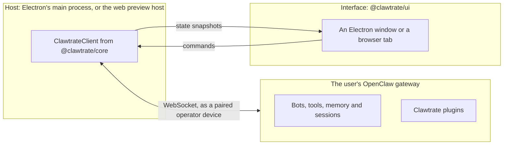

# Architecture

How Clawtrate's pieces fit together. The reasons behind each choice are in [decisions.md](decisions.md), and the engine's own guide is [packages/core/README.md](../packages/core/README.md).

## The short version

OpenClaw runs the bots. Clawtrate is only a client. One process, the host, holds the connection to the gateway, the device key and every task's state. The interface draws whatever state the host sends it and asks the host to act. It never talks to the gateway itself.

## The gateway

The user's OpenClaw gateway runs everything a bot does: models, tools, memory and sessions. Clawtrate connects to it as an operator device, through the official `@openclaw/gateway-client` and `@openclaw/gateway-protocol` packages, pinned to the gateway version named in [decisions.md](decisions.md#versions).

A device starts read-only, with `operator.read`. The first time a person sends, stops or answers something, the client asks once for the interactive tier: read, write, approvals and questions. It never asks for admin. Where the gateway cannot do something a feature needs, Clawtrate adds an OpenClaw plugin under `plugins/` rather than working around the gateway in the client.

## The engine: `@clawtrate/core`

`packages/core` holds the gateway connection, device pairing, the state of every bot, task and run, and the mapping from gateway events to what the interface shows. `ClawtrateClient`, in `src/client.ts`, is the one object a host creates.

Core has no DOM and no Node APIs. The host passes in a WebSocket factory, a key and value store, a device signer and its client identity (`src/host.ts`), so the same code can run in Electron, in Node and later in the Expo app. The Node versions of those pieces, a JSON file store, an Ed25519 key in a private file and Node's WebSocket, live behind `@clawtrate/core/node`. ESLint stops shared core code from importing `node:*`.

## The hosts

Electron's main process, in `apps/desktop/src/main`, is the host for the desktop app. The window runs with context isolation and the sandbox on and Node integration off. The preload script exposes a small API to the page, the window never navigates, and links open in the system browser.

The web preview host, in `apps/desktop/src/web-host`, is the host for a browser. It keeps the gateway connection and the device key in Node and serves the interface behind an access token that it makes at each start. A browser that presents the token gets a cookie, and every asset and the bridge's WebSocket need that cookie. It serves at most eight viewers at once, and each viewer receives only the tasks it has open. Because the key stays in Node, a plain `http://` page on another machine can still pair.

## The bridge

The host and the interface talk through one contract, `packages/core/src/bridge.ts`:

- The host pushes whole state snapshots, at most one every 16 ms.
- The interface sends commands. The host checks each one with `parseBridgeCommand` before it reaches the client, and refuses a command about a task unless that viewer has the task open.
- `invoke` sends a command and returns its answer, such as a sent message's id or a new task's key.

The desktop window gets the bridge over Electron's IPC, and a browser gets it over the web host's WebSocket (`createRemoteBridge`). Each window or tab is its own viewer. Which bot and task are selected lives in the interface, not in the host.

## The interface: `@clawtrate/ui`

`packages/ui` is the React interface: the rail of bots and tasks, the conversation, the cards, the Work pane and settings. The same components run in the Electron window, in a browser and in the fixture mode. They read state from the bridge and never import the gateway client.

## Building without a real gateway

Two tools let all of this be built and tested without anyone's real gateway or model account.

The development gateway, `tools/dev-gateway`, starts a real OpenClaw gateway in a profile of its own, with a scripted model that plays scenarios on demand and four seeded sample bots. Its configuration has to match a closed contract, so it cannot reach a real provider. [The development gateway guide](development/dev-gateway.md) covers it.

The fixture mode, `apps/desktop/src/fixture`, feeds the real interface fixed state through a fixture bridge. It needs no gateway at all, and the visual tests run against it. [Testing](development/testing.md) covers it.

## What is next

The iOS app is an Expo app in `apps/mobile` that runs the same `@clawtrate/core`, with the app supplying the WebSocket, storage and signing. [The iOS app](development/ios.md) says how to build and check it, and [the roadmap](roadmap.md#the-ios-app) what comes next.
